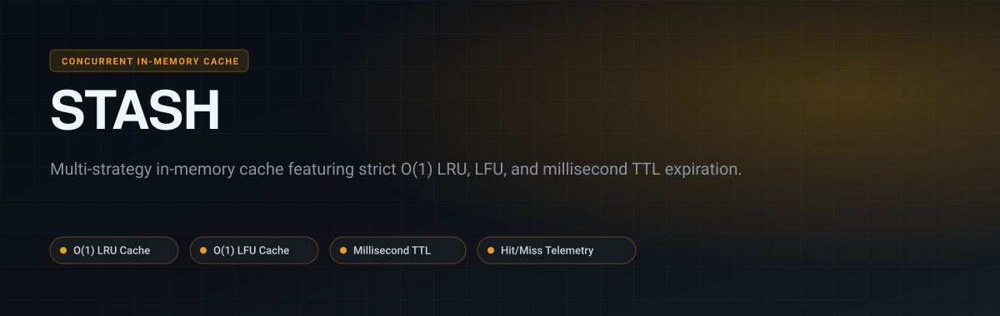
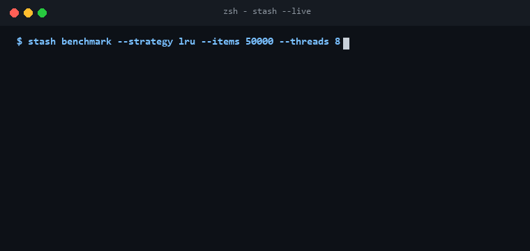

<p align="center">
  
</p>

<p align="center">
  <a href="https://github.com/Gaurav28-tech/stash/actions"></a>
  <a href="LICENSE"></a>
  
  
</p>

<p align="center">
  <b>Stash</b> is a concurrent, high-performance in-memory caching engine engineered in Python. It supports pluggable eviction algorithms—including Least Recently Used (<b>LRU</b>), Least Frequently Used (<b>LFU</b>), and Millisecond Time-to-Live (<b>TTL</b>)—alongside comprehensive cache efficiency telemetry.
</p>

---

## ⚡ Live Terminal Preview

<p align="center">
  
</p>

---

## 🚀 Key Capabilities

- **O(1) LRU Cache**: Implemented with doubly-linked lists and hash maps for constant-time lookups and evictions.
- **O(1) LFU Cache**: Frequency bucket architecture maintaining strict O(1) performance during frequency increments.
- **Precision TTL**: Lazy and active expiration sweeps for millisecond time-sensitive data.
- **Cache Observability**: Real-time telemetry tracking hit/miss ratios, eviction counts, and memory footprint estimations.
- **Thread-Safe**: Synchronized primitives ensuring concurrent thread safety across high-throughput web servers.

---

## 🏗️ Architecture

<p align="center">
  
</p>

---

## 📦 Quickstart

### Installation

```bash
git clone https://github.com/Gaurav28-tech/stash.git
cd stash
```

### Basic Usage

```python
from cacheflow.manager import CacheManager

# Unified Cache Manager with LRU eviction and TTL
cache = CacheManager(strategy="lru", capacity=100, default_ttl_seconds=60.0)

cache.set("user:101", {"name": "Alice", "role": "admin"})
user = cache.get("user:101")
print(f"Retrieved: {user}")

# Telemetry inspection
stats = cache.get_stats()
print(f"Hit Ratio: {stats.hit_ratio:.2%}, Total Evictions: {stats.evictions}")
```

### Running Test Suite

```bash
python -m unittest discover -s tests -p "test_*.py"
```

---

## 📄 License

Distributed under the [MIT License](LICENSE).
